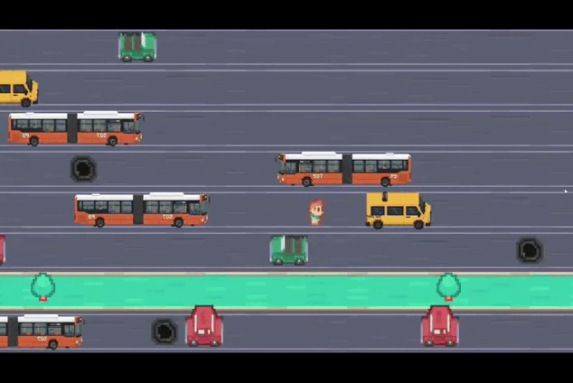
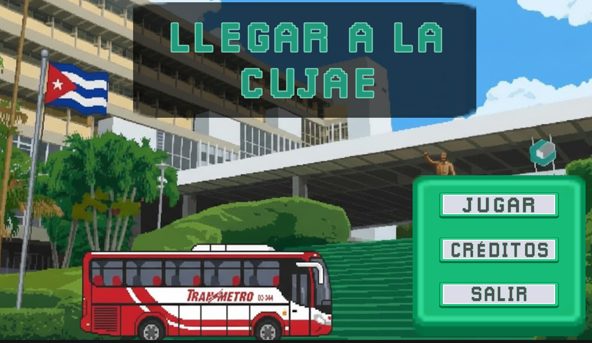
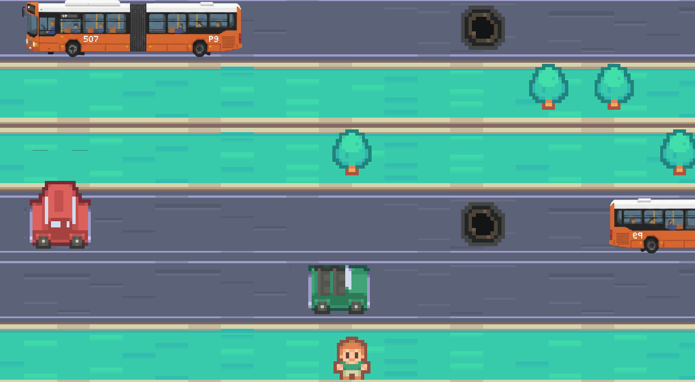
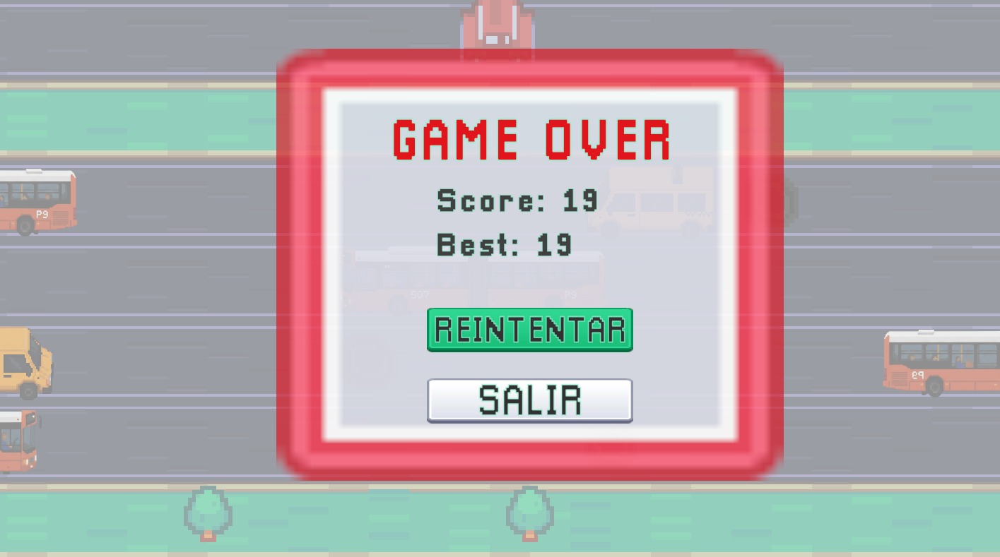

# 🎮 Llegar a la CUJAE

  

## 🎓 Proyecto Académico

> Proyecto Final – Asignatura de Desarrollo de Videojuegos  
> 4to Año – Ingeniería Informática  

## 🚀 Sobre el Proyecto

**Llegar a la CUJAE** es un videojuego arcade 2D infinito desarrollado en Unity, inspirado en *Crossy Road*.

El juego representa de forma lúdica como cruzar una avenida para llegar a tiempo a la Universidad Tecnológica de La Habana (CUJAE).  

El jugador debe avanzar infinitamente mientras evita vehículos en movimiento, supera obstáculos y trata de alcanzar la mayor puntuación posible.  

El juego combina:

- 🎨 Estética Pixel Art  
- 🛣️ Generación procedural del escenario  
- 🚗 Tráfico dinámico con velocidades variables  
- 📈 Sistema de puntuación basado en progreso vertical  
- 📱 Soporte multiplataforma  

---

## 🎮 Información del Juego

| Elemento | Detalles |
|----------|----------|
| **Título** | Llegar a la CUJAE |
| **Género** | Arcade / Infinito / Supervivencia |
| **Inspiración** | Crossy Road |
| **Motor** | Unity 2022.3.14f1 |
| **Lenguaje** | C# |
| **Tipo** | 2D |
| **Plataformas** | Windows, Android |

---

## 📦 Instalar

### 🔹 Ejecutar desde Unity
1. Clonar el repositorio:
2. Abrir el proyecto en **Unity 2022.3.14f1**
3. Ejecutar la escena principal

### 🔹 Descargar Ejecutables 

## 📸 Capturas del Juego

  
  
  

## 👥 Contribuidores

  
  
  
  
  

### Agradecimientos a:  
- <a href="https://github.com/AndyCG03">@AndyCG03</a>

### 📜 Licencia
MIT License

